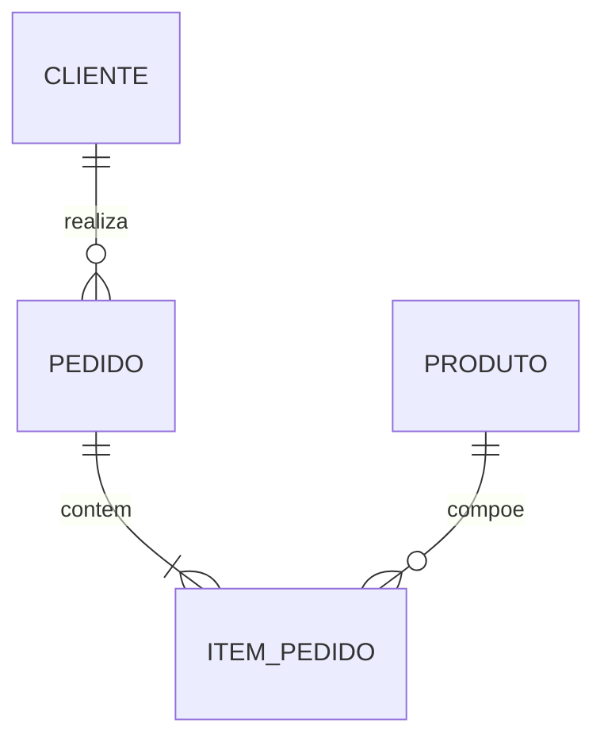

# Modelo Entidade-Relacionamento (ER)

## 1. Descrição do Mini-Mundo
(Descreva aqui a regra de negócio do trabalho acadêmico)

## 2. Entidades Principais
- **Entidade A**: Descrição
- **Entidade B**: Descrição

## 3. Relacionamentos e Cardinalidades
- **Entidade A** (1,N) --- [Realiza] --- (1,1) **Entidade B**

## 4. Diagrama Conceitual (Mermaid)

